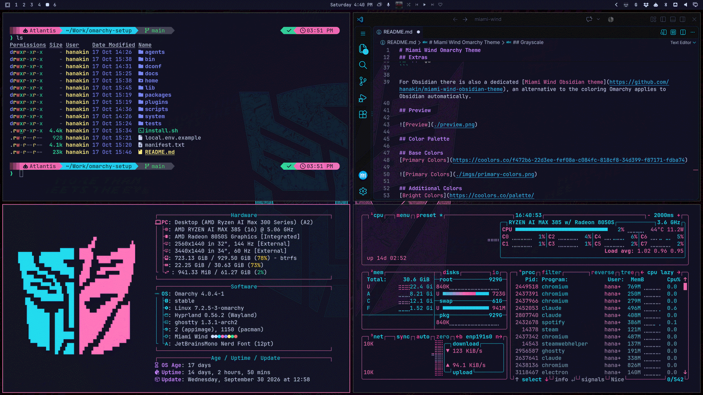
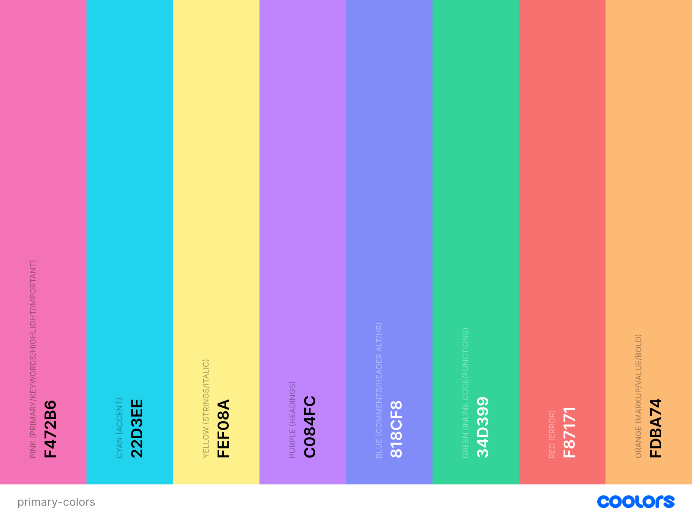
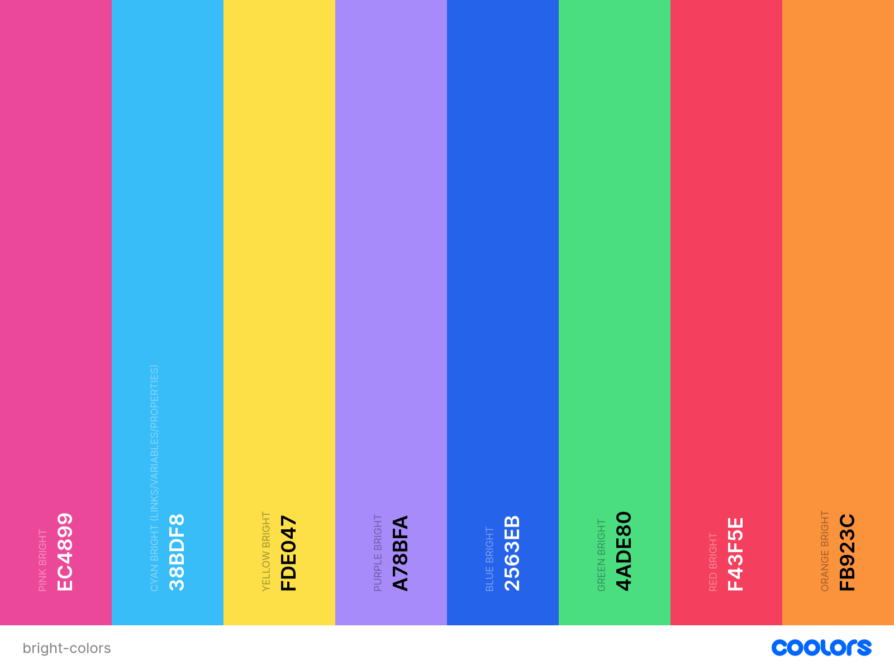
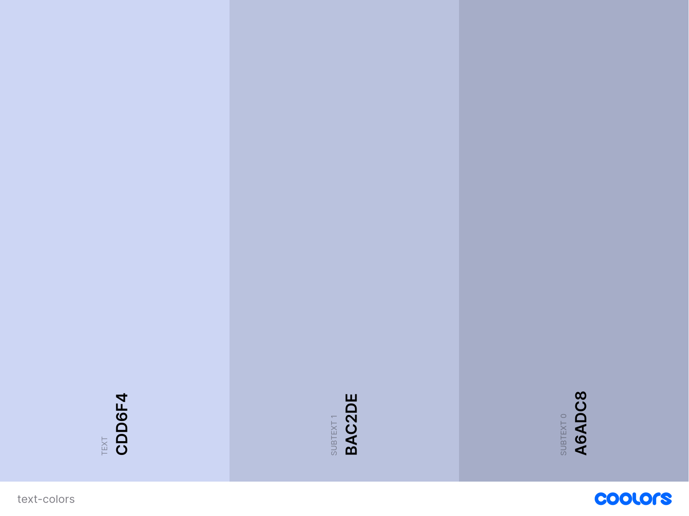
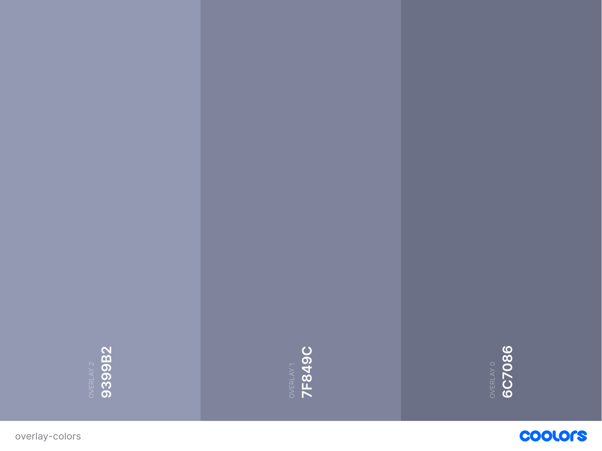
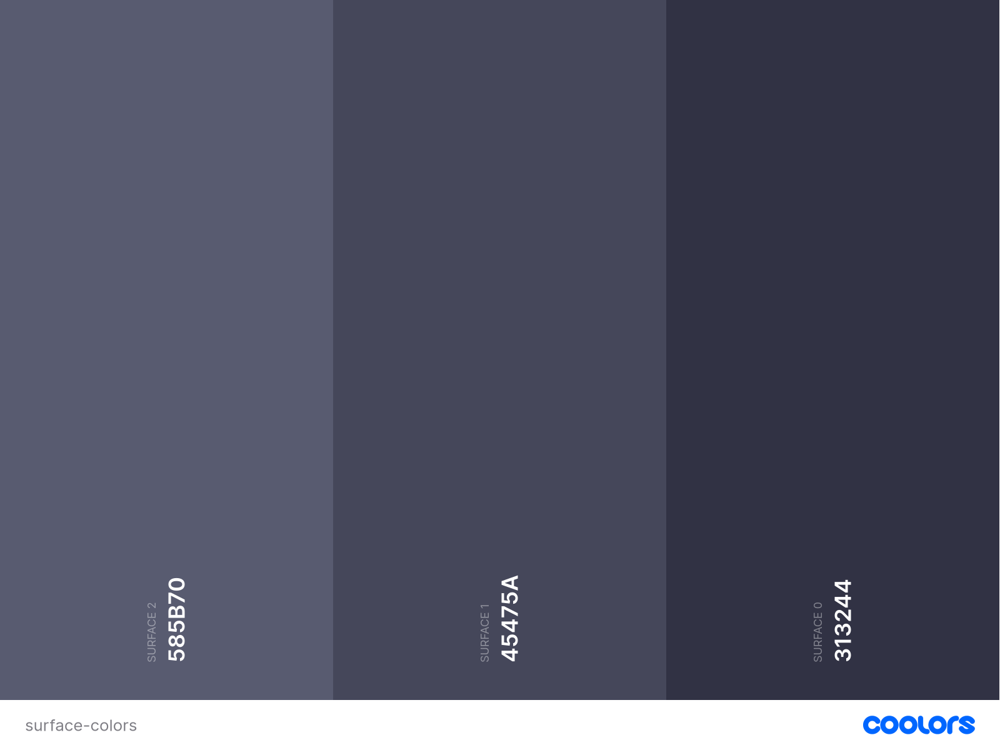
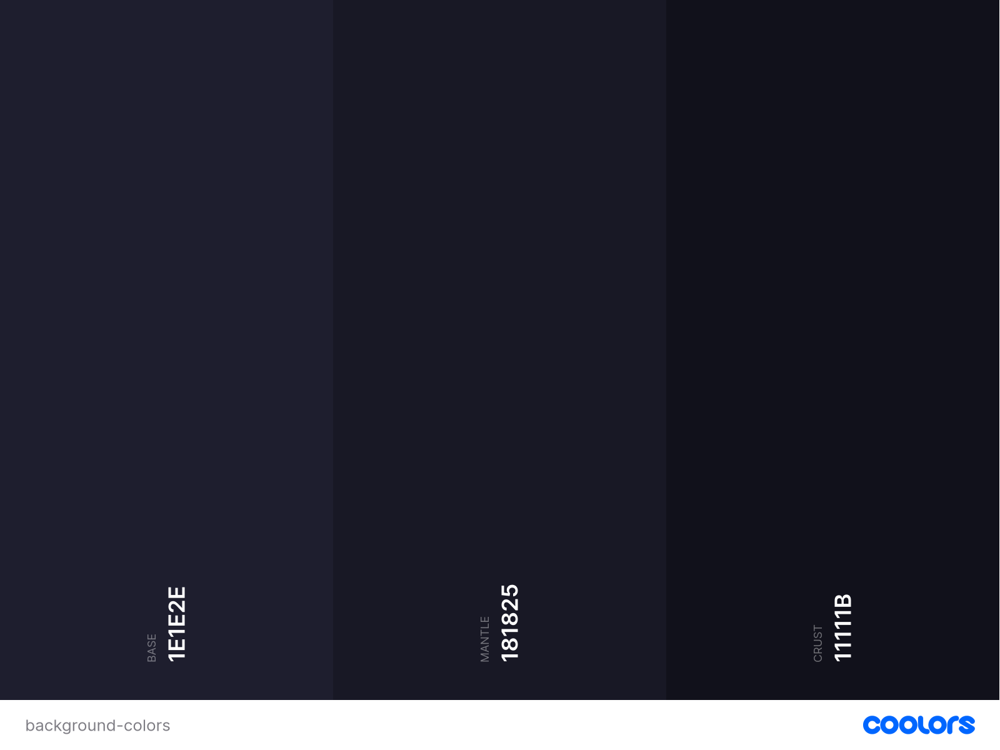

# Miami Wind Omarchy Theme
An Omarchy theme based on Miami Wind color scheme which is a blend of colors from [Tailwind CSS](https://tailwindcss.com/docs/colors) and Grayscale colors from [Catppuccin Mocha](https://catppuccin.com/) with inspiration from the theme [Miami Nights](https://github.com/monkeytypegame/monkeytype/blob/master/frontend/static/themes/miami_nights.css) for [Monkeytype](https://www.monkeytype.com). Color Swatches built using [Coolors](https://coolors.co/)

## Installation

```bash
omarchy theme install https://github.com/hanakin/omarchy-miami-wind-theme
```

That installs the colors: `colors.toml` drives the terminals, Hyprland borders, editors and the rest of Omarchy through its templates, alongside the shipped btop and Chromium colors, the icon setting and the backgrounds.

## Extras

The theme also ships a Starship prompt and a Fastfetch layout. Omarchy does not load either from a theme, so link your configs to the copies in the installed theme. Any existing file is moved aside with a `.bak.<timestamp>` suffix.

```bash
cd ~/.config && mkdir -p fastfetch
for f in starship.toml fastfetch/config.jsonc; do
  if [ -e "$f" ] || [ -L "$f" ]; then mv "$f" "$f.bak.$(date +%Y%m%d%H%M%S)"; fi
  ln -s ~/.config/omarchy/themes/miami-wind/"$f" "$f"
done
```

The prompt's glyphs need a Nerd Font in your terminal (Omarchy's default font is one).

The icon setting is `Flatery-Pink-Dark`. It takes effect once the [Flatery](https://github.com/cbrnix/Flatery) Pink Dark icons and the `Flatery` and `Flatery-Dark` base directories they link to are installed; until then apps use the default icons. The AUR package `flatery-icon-theme-git` installs only the two base directories, so copy all three from the source:

```bash
git clone --depth 1 https://github.com/cbrnix/Flatery.git /tmp/flatery
mkdir -p ~/.local/share/icons
cp -a /tmp/flatery/Flatery /tmp/flatery/Flatery-Dark /tmp/flatery/Flatery-Pink-Dark ~/.local/share/icons/
rm -rf /tmp/flatery
```

For Obsidian there is also a dedicated [Miami Wind Obsidian theme](https://github.com/hanakin/miami-wind-obsidian-theme), an alternative to the coloring Omarchy applies to Obsidian automatically.

## Preview



## Color Palette

## Base Colors
[Primary Colors](https://coolors.co/f472b6-22d3ee-fef08a-c084fc-818cf8-34d399-f87171-fdba74)



## Additional Colors
[Bright Colors](https://coolors.co/palette/ec4899-38bdf8-fde047-a78bfa-2563eb-4ade80-f43f5e-fb923c)



## Grayscale

[Text Colors](https://coolors.co/cdd6f4-bac2de-a6adc8)



[Overlay Colors](https://coolors.co/9399b2-7f849c-6c7086)



[Surface Colors](https://coolors.co/585b70-45475a-313244)



[Background Colors](https://coolors.co/1e1e2e-181825-11111b)

